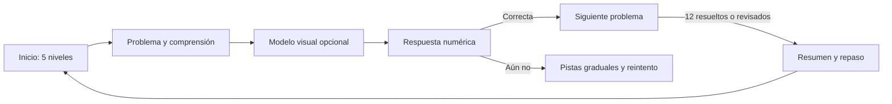

# Plan de implementación — Matemàtiques per pensar

## Ajuste curricular: repartos sin divisiones formales

- [x] Sustituir la división mostrada en los modelos por grupos iguales, sumas repetidas o multiplicaciones con incógnita.
- [x] Adaptar pistas y soluciones de los 60 ejercicios en catalán y castellano, sin revelar resultados en pistas ni cambiar las respuestas.
- [x] Comprobar que ningún texto visible presenta la operación de división y que los repartos siguen siendo matemáticamente correctos.

**Revisión:** barras con multiplicación e incógnita; las pistas y soluciones de reparto usan grupos iguales y multiplicación inversa. El catálogo conserva el operador interno solo para comprobar las respuestas. Las 11 pruebas de datos y los 14 recorridos de navegador pasan.

## Cierre de implementación y revisión para iPad

- [x] Comprobar y ajustar la interfaz y sus controles táctiles en tabletas verticales y horizontales.
- [x] Completar los recorridos, la persistencia, el repaso y la ayuda a la comprensión pendientes del MVP.
- [x] Revisar la correspondencia entre contenidos, modelos e ilustraciones, y cerrar las validaciones de datos.
- [x] Probar accesibilidad automática, navegación, cambio de idioma y resolución en tableta emulada y escritorio; documentar limitaciones verificables.

**Revisión:** pruebas táctiles con WebKit en tres tamaños de iPad, controles de 44 px, entradas de 16 px, borradores persistentes, repaso, panel de acompañamiento y validación del catálogo. Los 60 problemas usan escenas contextualizadas compartidas; quedan pendientes las 60 ilustraciones individuales planteadas inicialmente, la revisión con lector de pantalla y una comprobación en iPad físico. No hay una línea base visual previa para comparar regresiones.

## Guía de las herramientas

- [x] Incorporar una guía desplegable bilingüe para cada herramienta y para problemas de varios pasos.
- [x] Explicar los controles reales y cómo continuar los cálculos en papel, sin resolver ejemplos.
- [x] Verificar el cambio de herramienta e idioma y la navegación accesible; ejecutar pruebas y compilación.

**Revisión:** guías contextuales desplegables en catalán y castellano, con pasos específicos para cada modelo y para la herramienta elegida dentro de «Passos». Compilación, cuatro pruebas de catálogo y cinco recorridos de navegador superados, incluido el manejo de las guías por teclado.

## Ajuste: pensar con la app y calcular en papel

- [x] Revisar las cuatro herramientas y eliminar resultados y operaciones resueltas automáticamente, tanto visuales como para lectores de pantalla.
- [x] Conservar representaciones editables y añadir instrucciones concretas bilingües para que el alumno dibuje y calcule en papel.
- [x] Adaptar las tres pistas de los 60 ejercicios para orientar sin resolver los cálculos; mantener la solución explicada tras una acción explícita.
- [x] Verificar herramientas y pistas en ambos idiomas, incluyendo deshacer, reparto y ausencia de resultados automáticos; ejecutar pruebas y compilación.

**Revisión:** recta con saltos y puntos incógnita; barras y rectángulos sin cocientes o productos; reparto como registro de tandas sin saldo calculado. Compilación, cuatro pruebas de catálogo y cuatro recorridos de navegador superados.

**Estado:** aplicación funcional para prueba; quedan pendientes la prueba en iPad físico, la revisión con lector de pantalla y las ilustraciones individuales previstas.  
**Rama:** `codex/app-implementation`.  
**Fecha:** 27/10/2026  
**Alcance acordado:** React + TypeScript + Vite; 5 niveles de **12 problemas** (60 en total); catalán (`ca-ES`) como idioma inicial y castellano (`es-ES`) como alternativa completa; una ilustración contextual original por problema; sin cuentas, backend ni servicios de IA.

## 1. Resultado que se entregará

Una aplicación estática, responsive y accesible para que alumnado de 3r de Primària practique problemas contextualizados. El recorrido será:



La web validará únicamente la respuesta final de forma determinista. Los modelos visuales permitirán explorar estrategias sin marcar como inválido un procedimiento alternativo matemáticamente correcto. Todo progreso vivirá en el navegador del dispositivo.

## 2. Decisiones de alcance que se cierran antes de programar

- [ ] Mantener los cinco niveles actuales; ampliar cada uno de 6 a 12 ejercicios sin cambiar su objetivo curricular.
- [ ] Establecer `ca-ES` como idioma predeterminado y ofrecer un selector persistente `Català | Castellano` en toda la aplicación, sin depender del idioma del navegador.
- [ ] Traducir interfaz, problemas, pistas, soluciones, unidades, descripciones y textos alternativos al castellano; ninguna pantalla mezclará idiomas.
- [ ] Incluir una ilustración contextual original y sin texto incorporado para cada problema. Las imágenes acompañan la comprensión y nunca contienen datos necesarios para resolverlo.
- [ ] Cambiar los umbrales proporcionalmente: `≥8/12` recomienda continuar y `≥10/12` muestra `Dominat`; la repetición será siempre libre y sin penalización por pistas.
- [ ] Mantener `problems.seed.json` como fuente única de verdad. La ampliación no se duplicará en componentes.
- [ ] Usar React, TypeScript estricto y Vite. No habrá API, autenticación, analítica externa, publicidad ni cronómetros.
- [ ] Priorizar por este orden: contenido validado → recorrido y progreso → recta numérica → otros modelos → calidad y pruebas de usuario.
- [ ] Considerar el panel de adulto como P1: se limitará inicialmente a datos locales, no diagnósticos y sin perfiles.

## 3. Arquitectura objetivo

```text
src/
  app/                    # App, router, proveedores y rutas
  content/                # problems.seed.json, esquema y carga validada
  domain/                 # tipos, operaciones, progreso, niveles, migraciones
  features/
    home/                 # selector de niveles
    practice/             # sesión, pistas, respuesta y feedback
    summary/              # cierre, repaso y avance
    adult/                # P1: vista local y no diagnóstica
  components/             # layout y UI reutilizable, sin respuestas embebidas
  visual/                 # number-line, bar-model, array-model, groups, mixed
  hooks/                  # useProgress, useMediaQuery y utilidades de interacción
  styles/                 # tokens, estilos globales y componentes
  test/                   # factories, helpers y pruebas de componentes
e2e/                      # flujos Playwright
```

**Dependencias y scripts.** React Router para rutas declarativas; Zod para validar contenido y persistencia; CSS moderno propio (sin necesidad de un sistema UI pesado); Vitest, Testing Library, `jest-axe` y Playwright. Se expondrán `dev`, `build`, `test`, `test:coverage`, `test:e2e`, `lint` y `typecheck`.

**Separación obligatoria.** Las vistas no calcularán ni contendrán respuestas. El dominio tendrá funciones puras para normalizar entradas, evaluar resultados, resumir niveles, recomendar avance, recuperar datos corruptos y migrar progreso. Los modelos visuales recibirán una configuración tipada, nunca texto de problema interpretado ad hoc.

## 4. Datos, validación y progreso

### 4.1 Contrato de contenido

Conservar los campos actuales y añadir solo los que hagan explícita la configuración pedagógica:

```ts
type Step = {
  operator: '+' | '-' | '×' | '÷';
  operands: number[];
  result: number;
  expression: string; // Solo para presentar; no se ejecuta como código.
};

type Locale = 'ca-ES' | 'es-ES';
type LocalizedText = Record<Locale, string>;

type Problem = {
  id: `L${1 | 2 | 3 | 4 | 5}-${string}`;
  level: 1 | 2 | 3 | 4 | 5;
  title: LocalizedText;
  statement: LocalizedText;
  question: LocalizedText;
  answer: { value: number; unit: LocalizedText };
  steps: Step[];
  strategies: LocalizedText[];
  skillTags: string[];
  difficulty: 1 | 2 | 3;
  visualModel: 'numberLine' | 'barModel' | 'array' | 'groups' | 'mixed';
  representationConfig: Record<string, unknown>;
  illustration: { assetId: string; alt: LocalizedText; decorative: false };
  hints: [LocalizedText, LocalizedText, LocalizedText];
  workedSolution: LocalizedText;
};
```

La validación Zod se ejecutará al cargar el catálogo y en pruebas. Comprobará: exactamente 5 niveles × 12 ítems, IDs y títulos únicos, ambas traducciones no vacías, tres pistas no vacías en los dos idiomas, unidades, respuestas enteras, ilustración existente y con `alt` localizado, modelo permitido, configuración compatible y cada paso correctamente calculado. Las expresiones se tratarán como texto; las operaciones se verificarán desde la estructura `Step`, nunca con `eval`, `Function` ni fórmulas de usuario.

### 4.2 Progreso local

La clave evolucionará a `math-practice:v2`, con migración explícita desde `v1` para no perder lo ya guardado durante desarrollo. El adaptador de almacenamiento hará parseo seguro, validación Zod, migración y recuperación limpia ante JSON inválido.

```ts
type ProblemProgress = {
  status: 'unseen' | 'inProgress' | 'solved';
  attempts: Array<{ answerInput: string; correct: boolean; createdAt: string }>;
  hintsSeen: 0 | 1 | 2 | 3;
  solutionViewed: boolean;
  updatedAt: string;
};

type ProgressV2 = {
  schemaVersion: 2;
  contentVersion: string;
  currentProblemId?: string;
  byProblemId: Record<string, ProblemProgress>;
  updatedAt: string;
};
```

Un acierto posterior conservará los intentos anteriores y resolverá el problema. Las pistas y consultar una solución no restarán puntuación. El reinicio exigirá un diálogo accesible de confirmación y solo eliminará esta clave local.

## 5. Ampliación editorial: 60 problemas

Antes de integrar la ampliación, crear una propuesta editorial revisable con enunciado catalán, pregunta, unidad, tres pistas, solución trabajada, estrategia, modelo y configuración por cada nueva ficha. Una segunda revisión comprobará que no hay ambigüedad de referentes, unidades incongruentes, respuestas no enteras ni aumento artificial de dificultad lectora.

Los 30 existentes se conservan como `01–06`. Los siguientes son los seis nuevos compromisos de contenido por nivel; las operaciones indican la estructura de la solución, no el texto final del enunciado.

| Nivel | IDs nuevos y contexto propuesto | Operación / respuesta | Modelo y destreza |
|---|---|---:|---|
| 1 — Sumem i restem | `L1-07 Els llapis de la classe`; `L1-08 Les plantes del pati`; `L1-09 La col·lecció de petxines`; `L1-10 Les peces del puzle`; `L1-11 Els contes de préstec`; `L1-12 Les ampolles per reciclar` | 38+25=63; 91−46=45; 57+18=75; 70−27=43; 49+32=81; 86−41=45 | `numberLine`; suma/resta de un paso hasta 100, descomposición, paso por decena y compensación. |
| 2 — Dobles, meitats i complements | `L2-07 Les caixes de colors`; `L2-08 Les cireres del mercat`; `L2-09 Els punts del joc`; `L2-10 Les polseres bessones`; `L2-11 Les files de gots`; `L2-12 Les places de l’autocar` | 37×2=74; 88÷2=44; 100−67=33; 46×2=92; 28×2=56; 85−59=26 | Alternar `barModel` y `numberLine`; tres dobles, una mitad y dos complementos: junto a los existentes queda un reparto equilibrado 4/4/4 entre dobles, mitades y complementos. |
| 3 — Problemes de dos passos | `L3-07 La parada solidària`; `L3-08 Els llibres de l’aula`; `L3-09 La cursa escolar`; `L3-10 Els seients del teatre`; `L3-11 El material d’art`; `L3-12 La campanya de recollida` | 48+37−26=59; 128−45+16=99; 34+29→100−63=37; 52+39→125−91=34; 76−28+35=83; 27+46+18=91 | `mixed` y `numberLine`; decidir el orden de dos acciones con suma/resta y verbalizar el estado intermedio. |
| 4 — Multipliquem i repartim | `L4-07 Les files del jardí`; `L4-08 Els equips de relleus`; `L4-09 Les capses de retoladors`; `L4-10 Els dies del calendari`; `L4-11 Les rajoles del passadís`; `L4-12 Les bosses de llavors` | 7×6=42; 54÷6=9; 8×7=56; 48÷8=6; 9×4=36; 42÷7=6 | Alternar `array` y `groups`; con el catálogo actual, quedan seis multiplicaciones y seis repartos exactos. |
| 5 — El repte final | `L5-07 Les entrades del concert`; `L5-08 Les caixes de fruita`; `L5-09 Els cromos de l’intercanvi`; `L5-10 La fira de l’escola`; `L5-11 Les samarretes de l’equip`; `L5-12 Els llibres per prestatge` | 7×8−19=37; 72÷8×4=36; 64÷2+18−7=43; 5×9+28→100−73=27; 6×7+16=58; 63÷7×5=45 | `mixed`, con dos problemas de tres pasos (`L5-09`, `L5-10`) y el resto de dos; mezcla sin vocabulario más complejo que el de niveles previos. |

Reparto final previsto de representaciones: recta numérica para sumas, restas y complementos; barras para dobles/mitades; cuadrículas para multiplicaciones; grupos para repartos; mixto solo cuando hay más de una operación. Ningún modelo presentará como única estrategia la solución escrita.

## 6. Diseño de interacción por pantalla

### Idioma y localización

- El primer arranque será siempre en catalán. Un selector visible, semántico y navegable por teclado permitirá cambiar a castellano sin borrar el progreso ni reiniciar el problema actual.
- La preferencia se guardará separadamente en `math-practice:locale:v1`; si falta o es inválida, se recuperará `ca-ES`. La URL podrá reflejar el idioma como parámetro opcional para pruebas, pero no será la única fuente de estado.
- React recibirá un `LocaleProvider` tipado. Las vistas usarán `t(key)` para microcopy e `inLocale(localizedText)` para contenido; quedan prohibidos los literales de interfaz dentro de componentes.
- Fechas, numerales y mensajes se formatearán con `Intl` para el idioma activo. La respuesta numérica conserva la misma validación en ambos idiomas.
- La traducción castellana debe conservar cantidad, unidad y orden pedagógico de las pistas. El catalán mantiene la referencia curricular y editorial.

### Ilustraciones de contexto

Cada problema tendrá una imagen pequeña (`illustration.assetId`) que sitúe la historia —biblioteca, mercado, patio, cocina o deporte— sin resolverla visualmente. Se mostrará antes del modelo matemático con un `alt` específico y localizado que describa la escena, no la operación ni el resultado.

- **Dirección artística:** ilustración infantil editorial, amable y sobria, paleta suave y diversidad no estereotipada; sin personas reconocibles, logotipos, marcas, texto, letras ni cifras.
- **Producción:** crear y aprobar primero cinco muestras coherentes (una por nivel). Tras congelar los 60 enunciados, producir los 60 assets originales con una plantilla de prompt consistente. Se guardarán en `src/assets/illustrations/problems/` y se expondrán por un manifiesto tipado, nunca por URL externa.
- **Uso pedagógico:** el enunciado conserva todos los datos; las imágenes no tendrán conteos que revelen la respuesta.
- **Entrega técnica:** WebP/AVIF comprimido, sin metadatos personales, carga diferida salvo la imagen activa, espacio reservado para no desplazar el contenido y placeholder neutro si falta un asset.
- **Accesibilidad:** `alt` localizado y útil para una escena contextual. Si alguna imagen se vuelve ornamental, usará `alt=""`; nunca se incrustará texto funcional en píxeles.

### Inicio y nivel

- Cinco tarjetas con nombre, icono original, `12 problemes`, progreso `x/12` y CTA `Comença` o `Continua`.
- Selector de idioma permanente y etiqueta accesible; tarjetas, progreso y CTA se actualizan inmediatamente al cambiar el idioma.
- Todos los niveles permanecen accesibles; la recomendación de avance informa, no bloquea.
- El progreso se expresará en texto además de color y gráficos.

### Práctica

- Indicador `Problema x de 12`, título, enunciado, pregunta y botón `Què sabem?` que revela datos y pregunta sin elegir operación.
- Ilustración contextual localizada, con espacio reservado y complementaria al enunciado; puede ocultarse visualmente sin afectar a la resolución.
- Panel del modelo visual sugerido, visible pero plegable en móvil; permitir cambiar a otro modelo pertinente cuando el problema lo admita.
- Campo numérico con la unidad a la vista; aceptar solo enteros con espacios exteriores, pero no texto añadido ni expresiones. El error de formato explica cómo corregirlo.
- `Comprova` mantiene el foco en un mensaje de estado. Un fallo ofrece reintento y ayuda, no la respuesta.
- `Necessito una pista` muestra una por pulsación y en orden. Tras la tercera, `Veure una possible solució` será una acción explícita y reversible.
- Al acertar, mostrar feedback amable, reflexión opcional `Com ho has pensat?`, siguientes acciones y guardado inmediato.

### Cierre, repaso y adulto

- Resumen de 12: resueltos, intentos y pistas por habilidad; no usar etiquetas diagnósticas.
- `Torna a practicar` prioriza no resueltos o con varios intentos, pero todos siguen disponibles.
- Vista adulta P1 con el mismo historial local, explicación de límites de interpretación y botón de reset protegido.

## 7. Laboratorios visuales: contrato funcional

| Componente | Interacción mínima verificable | Restricciones de calidad |
|---|---|---|
| `NumberLine` | Elegir inicio, añadir saltos positivos/negativos, editar valor, deshacer y borrar; resultado acumulado visible. | El signo y orden son coherentes; controles de teclado equivalentes; SVG con texto alternativo; no se usa para calificar el método. |
| `BarModel` | Configurar total y dos o más partes; dividir/combinar visualmente para doble, mitad y comparación. | Etiquetas de todo/partes, no insinuar una suma inexistente; alternativa textual de cada relación. |
| `ArrayModel` | Elegir filas y columnas, mostrar producto y particionar una dimensión. | Bloques simplificados para números grandes, sin cuadrículas ilegibles en móvil; factores y producto anunciados. |
| `GroupModel` | Repartir por lote, ver cantidad por grupo y restablecer. | Igualdad entre grupos visible; no exigir docenas de arrastres; botones y drag opcional con alternativa de teclado. |
| `MixedModel` | Ver pasos como `Primer… / Després…` y elegir qué cálculo explorar. | Nunca corregir el orden alternativo si lleva al resultado; enlaza uno o dos submodelos. |

## 8. Fases, entregables y puertas de verificación

### Fase 0 — Inicialización y contenido

- [ ] Crear Vite + React + TypeScript estricto y configurar lint, formato, Vitest, Testing Library, `jest-axe` y Playwright.
- [ ] Instalar la estructura de carpetas y scripts de calidad.
- [ ] Crear `LocaleProvider`, catálogo de microcopy catalán/castellano y contrato `LocalizedText` antes de montar vistas.
- [ ] Convertir/validar el banco a 60 problemas bilingües, añadir manifiesto de ilustraciones y congelar el esquema Zod.
- [ ] Aprobar la dirección artística mediante cinco muestras originales antes de producir los 60 assets finales; garantizar que no incluyen texto, cifras, marcas ni datos resolutivos.
- [ ] Añadir tests del catálogo y de pasos estructurados sin evaluación de código.
- [ ] **Puerta:** `typecheck`, lint, tests de contenido y build superan; 5×12, dos idiomas y manifiesto de ilustraciones validados.

### Fase 1 — Dominio, navegación y práctica base

- [ ] Implementar operaciones puras, validador de respuesta, progreso V2, migración y recuperación de almacenamiento corrupto.
- [ ] Construir inicio, rutas, selector de niveles, sesión de práctica, pistas, feedback y navegación.
- [ ] Integrar el selector de idioma persistente y conservar estado de sesión y progreso al alternar idioma.
- [ ] Persistir respuesta, pistas, posición y estado tras cada acción relevante.
- [ ] Crear resumen de nivel, umbrales 8/12 y 10/12, y reset confirmado.
- [ ] **Puerta:** resolver un problema, fallar, pedir pista, acertar, recargar y continuar funciona solo con UI de texto.

### Fase 2 — Recta numérica

- [ ] Construir `NumberLine` SVG controlado, con estado editable y operaciones seguras.
- [ ] Integrarlo en problemas de suma, resta y complemento sin acoplarlo a una única solución.
- [ ] Añadir pruebas de saltos, edición, borrado, deshacer, foco y equivalentes accesibles.
- [ ] **Puerta:** un niño puede explorar con ratón, tacto o teclado y el modelo sigue siendo comprensible en 320 px.

### Fase 3 — Barras, arrays, grupos y mixtos

- [ ] Implementar e integrar `BarModel` para dobles, mitades y comparaciones.
- [ ] Implementar `ArrayModel` para grupos iguales y particiones de factores.
- [ ] Implementar `GroupModel` con reparto por lote y sin arrastre obligatorio.
- [ ] Implementar `MixedModel` como composición guiada de modelos, no un motor de corrección de trazos.
- [ ] **Puerta:** cada modelo representa matemáticamente los 60 ítems que lo usan y ofrece control y descripción equivalentes.

### Fase 4 — Repaso, adulto y calidad de producto

- [ ] Añadir cola de repaso, resumen pedagógico no diagnóstico y panel de adulto P1.
- [ ] Aplicar diseño mobile-first, tokens visuales sobrios, estados vacíos y microcopy íntegramente localizado en catalán y castellano.
- [ ] Integrar las 60 ilustraciones contextualizadas, revisar su `alt` en los dos idiomas, su carga, compresión y comportamiento si faltan.
- [ ] Revisar contrastes, objetivos táctiles, foco, lectura por pantalla, movimiento reducido y errores de formulario.
- [ ] **Puerta:** flujo manual completo en móvil, tableta y escritorio sin pérdidas de estado ni dependencia del color.

### Fase 5 — Cierre y entrega

- [ ] Completar E2E de recorrido principal, reset y al menos un laboratorio visual.
- [ ] Ejecutar accesibilidad automática y revisión manual con teclado y lector de pantalla disponible.
- [ ] Añadir README: instalación, scripts, modelo de datos, privacidad, arquitectura, decisiones y limitaciones.
- [ ] Comparar criterios de aceptación del PRD, revisar diff y corregir regresiones.
- [ ] **Puerta:** build, typecheck, lint, unitarias, integración, accesibilidad y E2E en verde; demo manual documentada.

## 9. Matriz de pruebas

| Capa | Casos obligatorios |
|---|---|
| Catálogo | 60 totales, 12 por nivel, IDs únicos, tres pistas, unidades, pasos, respuestas y traducciones correctos en `ca-ES` y `es-ES`; modelo/configuración e ilustración válidos. |
| Dominio | Normalización de entrada, formato inválido, exactitud, estados del problema, cálculo de resumen/umbrales, migración V1→V2 y almacenamiento corrupto. |
| Componentes | Pistas secuenciales, fallo sin solución automática, reintento, feedback, persistencia, reset con confirmación y navegación. |
| Localización e imagen | Catalán inicial, alternancia sin perder sesión, preferencia persistente, cobertura total de claves, asset existente, `alt` útil localizado, error de carga y reserva de espacio. |
| Modelos | Operaciones, edición, deshacer y reset de recta; relaciones de barras; factores/particiones de array; igualdad/reparto por lote; alternativa de teclado en todos. |
| Accesibilidad | `jest-axe`, foco visible, nombres accesibles, orden de tabulación, `aria-live`, contraste, SVG descrito, 320 px y `prefers-reduced-motion`. |
| E2E | Inicio → pista → fallo → reintento correcto → recarga → continuidad → resumen; reset; un modelo visual por teclado/tacto. |

## 10. Riesgos y mitigación

| Riesgo | Mitigación y criterio de decisión |
|---|---|
| Construir cuatro modelos a la vez diluye calidad. | Cerrar primero flujo completo y recta numérica; solo abrir el siguiente modelo tras pasar su puerta. |
| Convertir la interacción en una validación rígida del procedimiento. | El dominio corrige solo respuesta final; los modelos muestran exploración y coherencia local. |
| Ampliar a 60 con ejercicios repetitivos o ambiguos. | Propuesta editorial, matriz de habilidades, doble revisión catalana/pedagógica y tests de datos antes de UI. |
| LocalStorage cambia de forma o se corrompe. | Esquema versionado, migración aislada, parseo defensivo, backup opcional durante desarrollo y reset recuperable. |
| Traducción parcial o divergencia pedagógica entre idiomas. | Un contrato bilingüe bloquea datos incompletos; prueba de cobertura de claves y revisión editorial que compara datos, pregunta, pistas y solución. |
| Imágenes pesadas, con texto erróneo o que revelan la respuesta. | Guía aprobada antes de producir, prompt que prohíbe texto/números, revisión visual, manifiesto local, compresión y prueba de que el enunciado contiene todos los datos. |
| SVG manipulable no resulta accesible. | Diseñar primero controles semánticos; el SVG complementa, no sustituye, botones y texto. |
| Alcance P1 desplaza los P0. | Mantener panel adulto, voz y PWA fuera del camino crítico hasta terminar todos los criterios P0. |

## 11. Definition of Done

- [ ] Se ven 5 niveles con exactamente 12 problemas distintos cada uno, sin cuenta y con catalán como idioma inicial.
- [ ] La aplicación permite cambiar a castellano en cualquier pantalla; ambos idiomas cubren el 100 % de interfaz, contenido, unidades, pistas, soluciones y alternativas de imagen.
- [ ] Los 60 problemas superan validación de contenido bilingüe, tienen respuesta/unidad/pistas/solución, ilustración contextual y se calculan sin ejecutar texto como código.
- [ ] Inicio, práctica, pistas, reintentos, solución opcional, siguiente, resumen y repaso funcionan y persisten tras recargar.
- [ ] La recta, barras, cuadrícula, reparto y mixto funcionan como herramientas, no como decoración, y tienen equivalentes de teclado/texto.
- [ ] Los umbrales, reset confirmado, responsive y accesibilidad cumplen los criterios definidos.
- [ ] `npm run typecheck`, `npm run lint`, `npm run test`, `npm run test:e2e` y `npm run build` pasan en una copia limpia.
- [ ] README y el registro de decisiones describen instalación, límites y privacidad.

## 12. Revisión de este plan

### Evidencia de partida

- [x] Revisado PRD: alcance, prioridad P0/P1, criterios de aceptación y riesgos.
- [x] Revisado banco actual: 30 problemas, 6 por nivel; respuestas y pasos consistentes.
- [x] Identificada la ampliación requerida a 60 ítems y recalculados los umbrales proporcionales.
- [x] Contraste técnico de arquitectura, persistencia, modelos, accesibilidad y estrategia de pruebas.
- [x] Actualizado el plan: catalán como idioma inicial, castellano completo como alternativa e ilustraciones originales contextualizadas por problema.

### Pendiente de aprobación

- [x] Confirmar este plan antes de crear el proyecto y modificar el catálogo.
- [ ] Confirmar si el panel adulto P1 debe formar parte de la primera entrega o quedar tras el MVP P0.
- [ ] Cuando se apruebe la implementación, crear/recuperar una rama de trabajo escribible y ejecutar las fases en orden.

### Revisión de implementación — 27/10/2026

- Implementada una primera versión ejecutable de React/TypeScript/Vite con 60 ejercicios bilingües, selector de idioma, práctica, pistas, respuesta, progreso local, resumen y cinco herramientas visuales.
- Las pruebas de datos y cuatro recorridos E2E pasan. Se aclararon los enunciados L3-06 (cada persona ocupa una silla) y L5-10 (las bolsas ya están llenas) para eliminar ambigüedad.
- Producidas cinco ilustraciones originales de escenas compartidas y vinculadas por temática. Quedan pendientes las 60 ilustraciones individuales previstas, la optimización de assets, el control de referencias por problema y una revisión editorial y pedagógica independiente.
- Quedan pendientes del plan: esquema de validación runtime completo, configuración inicial de los modelos por problema, panel adulto P1, repaso priorizado, auditoría manual de accesibilidad y verificación de todos los criterios en una instalación limpia. No se marca la definición de terminado como completada.
